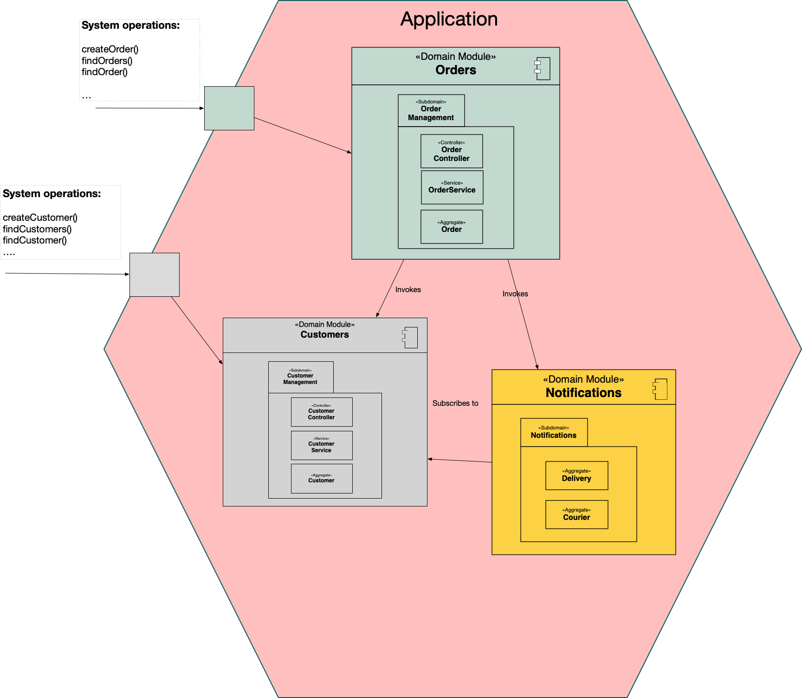

= Modular monolith example: customers and orders

This application is an example of a https://microservices.io/post/architecture/2023/07/31/how-modular-can-your-monolith-go-part-1.html[modular monolith architectural style].

## The application consists of three domain modules

It consists of three domain modules:

* `customers` - manages customers
* `orders` - manages orders
* `notifications` - sends notifications

## A domain module has a hexagonal architecture

A domain module has a hexagonal architecture:

* `domain` - the business logic
* `web` - an inbound adapter that implements a REST API
* `persistence` - an outbound adapter that implements database access

## Domain module collaboration mechanisms

Domains collaborate in two different ways.
The first is by one domain invoking another.
For example:

[java]
----
  @Transactional
  public Order createOrder(long customerId, Money orderTotal) {
      ...
      customerCreditService.reserveCredit(customerId, order.getId(), orderTotal);
----

`CustomerCreditService` is an interface that the `Orders` domain defines.
It describes what `Orders` needs from `Customers`.
An outbound adapter in the `Orders` domain module implements it by calling the `Customers` domain module's API, which can be either a POJO API or a gRPC API.
See <<_a_domain_module_api_can_be_a_pojo_api_or_a_grpc_api>>.

The second collaboration mechanism is the https://microservices.io/post/architecture/2023/10/30/how-modular-can-your-monolith-go-part-5-domain-observers.html[Observer pattern] - one domain subscribes to events emitted by another domain.
For example:

[java]
----
@Service
public class NotificationServiceImpl implements CustomerDomainObserver {

  @PostConstruct
  public void registerCustomerDomainObserver() {
    customerDomainObservers.registerObserver(this);
  }

  @Override
  public void noteCustomerCreated(CustomerInfo customerInfo) {...}
----      

Note: For simplicity, https://microservices.io/post/architecture/2023/11/13/how-modular-can-your-monolith-go-part-6-transactional-commands.html[the observers are executed in the publisher's transaction].

## A domain module API can be a POJO API or a gRPC API

The `Customers` domain module has two different versions of its credit management API:

* POJO API - the `CreditManagement` Java interface, defined by `customers-api-credit-management-pojo`
* gRPC API - `CreditManagementService`, a gRPC service defined by `customers-api-credit-management-grpc`

By default, `Orders` uses the POJO API.
When the `grpc` Spring profile is active, `Orders` uses the gRPC API.

The gRPC option uses an https://grpc.github.io/grpc-java/javadoc/io/grpc/inprocess/InProcessServerBuilder.html[in-process gRPC server], so the call stays inside the monolith's JVM.
It shows that a domain module can expose a language-neutral API, defined by a `.proto` file, without becoming a separate service.

The gRPC option consists of these Gradle sub-projects:

* `customers-api-credit-management-grpc` - the Domain API sub-project: `credit_management.proto` and the generated Java classes
* `customers-credit-management-grpc-server` - an inbound adapter in `Customers` that implements the gRPC service by delegating to `CreditManagement`
* `orders-credit-management-grpc-proxy` - an outbound adapter in `Orders` that implements `CustomerCreditService` using a gRPC blocking stub

The POJO option is implemented by `orders-credit-management-pojo-proxy`, an outbound adapter in `Orders` that implements `CustomerCreditService` by calling `CreditManagement`.

`orders-domain` depends on neither API.
It only depends on its own `CustomerCreditService` interface.
As a result, switching between the POJO API and the gRPC API doesn't require `orders-domain` to be changed, recompiled or retested.

### A gRPC call runs in the caller's transaction

The server and the client channel use `directExecutor()`, and the proxy uses a blocking stub.
As a result, a gRPC call runs on the caller's thread and joins the caller's transaction, just like a POJO API call.

The gRPC server maps exceptions to status codes:

* `CustomerNotFoundException` - `NOT_FOUND`
* `CustomerCreditLimitExceededException` - `FAILED_PRECONDITION`

The proxy throws `StatusRuntimeException` for an error status, which rolls back the caller's transaction.

### Running the application with the gRPC API

Activate the `grpc` Spring profile, for example:

[source,bash]
----
./gradlew :main:bootRun --args='--spring.profiles.active=grpc'
----

`CustomersAndOrdersGrpcApplicationTest` runs the application's component tests with the `grpc` profile active.

## Minimizing build-time coupling is a key design goal

X is https://microservices.io/post/architecture/2023/09/12/how-modular-can-your-monolith-go-part-4-physical-design.html#apply-physical-design-principles-to-reduce-build-time-coupling[build-time coupled] to Y if a change to Y requires X to be recompiled and, more importantly, retested.
Since fast builds are essential, it's important to minimize build-time coupling.

This example minimizes build-time coupling in a few different ways:

* Domain module = multiple Gradle projects
* Domain modules have a Domain API Gradle sub-project
* Uses the Interface Segregation Principle (ISP) to define narrower APIs.

### Domain module = multiple Gradle projects

To reduce build-time coupling within a domain module, each domain module consists of multiple Gradle sub-projects.
Typically, the sub-projects correspond the elements of the hexagonal architecture - domain or adapter.
For example, the `Customers` domain consists of multiple Gradle sub-projects including `customers-domain`, `customers-web`, and `customers-persistence`.
An important benefit of this design is that it reduces build-time coupling.
A change, for example, to the `web` adapter doesn't require the `domain` or `persistence` adapter to be recompiled/retested.

### Domain modules have a Domain API Gradle sub-project

The `Customers` and `Notifications` domain modules - specifically their domain logic - are used by other domain modules:

* `Orders` invokes `Customers` to reserve and release credit, and invokes `Notifications` to send emails
* `Notifications` registers with `Customers` as an observer, so that it's notified when a customer is created

In order to minimize build-time coupling, each of those domain modules has a https://microservices.io/post/architecture/2023/09/12/how-modular-can-your-monolith-go-part-4-physical-design.html#using-domain-api-modules-to-reduce-build-time-coupling[Domain API Gradle sub-project], which defines that module's API.
For example, the `Customers` domain has a `customers-api` Gradle sub-project, which contains its API classes.

A domain module's clients only depend on its Domain API Gradle sub-project.
Moreover, its clients are tested using mocks of the API.
For example, the `Orders` domain is tested using a mock of `CustomerCreditService`, which `Orders` uses to call the `Customers` domain's API.
As a result, a domain module's implementation can be changed without having to recompile/retest its clients.

### Uses the Interface Segregation Principle (ISP) to define narrower APIs.

To further reduce build-time coupling, the `Customers` domain module uses the https://microservices.io/post/architecture/2023/09/12/how-modular-can-your-monolith-go-part-4-physical-design.html#applying-the-interface-segregation-principle-isp[Interface Segregation Principle (ISP)] to define narrower APIs.
It has three Domain Modules API Gradle sub-projects:

* `customers-api` - defines CRUD operations
* `customers-api-credit-management-pojo` - defines operations for managing credit
* `customers-api-observer` - for registering observers of the `Customers` domain

As a result, each client only build-time coupled to those APIs that it's actually using.

### Code Tours

This repository includes a series of https://marketplace.visualstudio.com/items?itemName=vsls-contrib.codetour[Code Tours] that explain the design of the application.
You can use the code tours in either Visual Studio Code or Github Codespaces.

=== In Visual Studio Code

1. Install the Code Tour extension from the Visual Studio Code Marketplace
2. Use the `CodeTour: Start Tour` command from the command palette to start the tour

=== In a Github Codespace

1. https://codespaces.new/cer/modular-monolith-examples-customers-and-orders/tree/main[Create the codespace]
2. If necessary, install the Code Tour extension from the Visual Studio Code Marketplace.
3. Use the `CodeTour: Start Tour` command from the command palette to start the tour.

